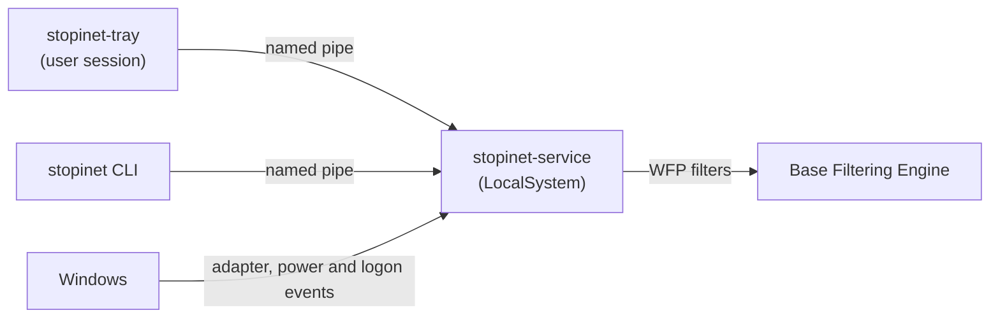

<div align="center">


# stop-internet

**Fail-closed kill switch for TUN-based VPN clients on Windows**

Nothing reaches the internet past the tunnel: not before the VPN connects,
not while it reconnects, not after it crashes.

[](https://github.com/Morkoshka/stop-internet/actions/workflows/ci.yml)
[](LICENSE)


[](https://github.com/Morkoshka/stop-internet/wiki)

English · [Русский](README.ru.md)

</div>

> [!WARNING]
> Early development. The service, the tray icon and the command-line tool
> have passed the manual tests on a real machine; the installer is new.
> There are no release builds yet: you build the programs and the installer
> from source.

## Why

A TUN-based VPN client routes traffic into its virtual adapter, but nothing
stops applications from using the physical adapter while the tunnel is not
there. Diagnostics with [Happ](https://www.happ.su) 4.3 on Windows showed
two real leaks:

- connections opened during a reconnect stayed on the physical adapter after
  the tunnel came back;
- a Windows system service kept a connection from boot outside the tunnel
  for the whole session.

Built-in protections of VPN cores go away when the core exits, which is
exactly when they are needed.

## Features

- **Tunnel or nothing.** While protection is on, applications reach the
  internet only through the tunnel. When it goes down, traffic is blocked at
  once.
- **Fail-closed.** If the VPN client, its core or stop-internet crashes, or
  the machine reboots, the block stays: the baseline lives in the Windows
  Filtering Platform itself.
- **The VPN client stays in charge.** Rule sets, direct rules and per-app
  exclusions keep working. Apps excluded from the tunnel, a game for
  example, keep working when it drops.
- **No leaks on the side.** DNS to the router, IPv6 and Teredo outside the
  tunnel are blocked.
- **Tray icon.** Shows the state at a glance and switches modes. It follows
  the VPN client by itself: proxy mode while the client runs as the system
  proxy, tunnel-only mode otherwise.
- **Off only on purpose.** Turning protection off needs a UAC prompt, lasts
  15 minutes, an hour or until the next reboot, sleep or sign-in, and then
  ends by itself.

## Modes

| Icon | Mode | Internet for applications |
|:-:|---|---|
|   | **Tunnel only**: the default after every boot, wake-up and sign-in | only through the tunnel; blocked while it is down |
|  | **Proxy**: for the VPN client in system proxy mode, without TUN | through the tunnel or the client's local proxy |
|  | **Normal internet**: 15 min, 1 h or until reboot, sleep or sign-in | unrestricted |

The icon is green while the internet works through the VPN, red while it is
blocked (no tunnel, or the service is not running) and grey while
protection is off. The signs differ too, so the states can be told apart
without colors.

The tray menu speaks the display language of Windows, Russian or English:

```text
Tunnel only
internet through the VPN
──────────────────────
✓ Automatic                    pick the mode by the system proxy
● Tunnel only
  Proxy
  Normal internet  ›           for 15 minutes, 1 hour, until reboot
──────────────────────
  Service log
  Close icon
```

## How it works



The service keeps a persistent baseline of WFP filters that blocks
everything except loopback, DHCP, IPv6 neighbor discovery and excluded apps.
While the tunnel adapter is up, it adds session filters for the tunnel and
for the VPN daemon that carries it. The baseline survives reboots and
crashes; the session filters vanish with the service. A sublayer of its own
with the highest weight means no allow rule of Windows Firewall or other
software can open a hole.

The [design document](docs/design.md) has the threat model, the rule table,
the WFP mapping and the reasons behind each decision.

## Getting started

**Requirements:** Windows 10 or 11 on x64, [Rust](https://rustup.rs) with
the MSVC toolchain, [Inno Setup](https://jrsoftware.org/isinfo.php) 6.4 or
later for the installer, an elevated PowerShell for everything that
installs.

1. Build and run the tests:

   ```powershell
   cargo build --release
   cargo test
   ```

2. Copy [`config/stopinet.example.toml`](config/stopinet.example.toml) to
   `config/stopinet.local.toml` (ignored by git) and fill in your VPN
   client: the tunnel adapter, its processes and the apps it excludes. The
   example is set up for Happ. See the rules it gives without touching the
   system:

   ```powershell
   .\target\release\stopinet.exe policy --config config\stopinet.local.toml --mode tunnel --tunnel down
   ```

3. Try the rules for two minutes; they roll back by themselves:

   ```powershell
   .\target\release\stopinet.exe trial --config config\stopinet.local.toml
   ```

4. Build the installer:

   ```powershell
   .\tools\build-installer.ps1
   ```

   It writes `target\installer\stop-internet-<version>-setup.exe`. Run it
   with your configuration, given by its full path:

   ```powershell
   .\target\installer\stop-internet-<version>-setup.exe /CONFIG="$PWD\config\stopinet.local.toml"
   ```

   The wizard speaks Russian or English, like Windows. "Trial mode" on its
   tasks page keeps nothing persistent, so a stop of the service leaves the
   machine as it was; run the installer again without it for the
   persistent baseline. Without `/CONFIG` the installer keeps the installed
   configuration, or installs the example for Happ.

   The programs go to `C:\Program Files\stop-internet`, the configuration
   to `C:\ProgramData\stop-internet`, and the tray icon starts at every
   sign-in. The Start menu gets the icon, "emergency off" and the recovery
   guide; Settings → Apps uninstalls it.

   Without the installer, the command-line tool does the same, except the
   Start menu and Settings → Apps; `--session-only` is the trial mode:

   ```powershell
   .\target\release\stopinet.exe install --config config\stopinet.local.toml --session-only
   ```

> [!CAUTION]
> Keep the way out at hand: Start menu → "stop-internet - emergency off",
> or `stopinet panic`. Both stop the service and remove every filter, the
> persistent ones included, and need no network. Protection returns when
> the service starts again. The [recovery guide](docs/recovery.md) covers
> the rest. Go through the [manual tests](docs/testing.md) before relying
> on it.

### Everyday use

The tray icon is all you need. From a terminal (`stopinet` is
`C:\Program Files\stop-internet\stopinet.exe`, which is not on `PATH`):

```powershell
stopinet status                      # service, mode, filters, tunnel
stopinet mode proxy                  # or tunnel
stopinet mode normal --minutes 15    # elevated terminal only
stopinet uninstall                   # without the installer; configuration and log stay
```

While "Automatic" is on in the tray menu, the tray sets the protected
mode back to the one that fits the system proxy.

## Documentation

- **[Design](docs/design.md)**: threat model, modes, rules, WFP filters,
  lifecycle and the reasons behind the decisions.
- **[Manual tests](docs/testing.md)**: what to check on a real machine,
  step by step.
- **[Recovery guide](docs/recovery.md)**: what to do when the internet does
  not work, from turning protection off for a while to programs gone
  missing.
- **[Wiki](https://github.com/Morkoshka/stop-internet/wiki)**: the same
  documents, in English and Russian.

<details>
<summary><b>Repository layout</b></summary>

| Path | Content |
|---|---|
| `crates/stopinet-core` | configuration, policy model, modes, pipe protocol; no unsafe code |
| `crates/stopinet-win` | WFP engine, persistent baseline, tunnel adapter lookup, named pipe |
| `crates/stopinet-service` | Windows service |
| `crates/stopinet-tray` | tray icon |
| `crates/stopinet-cli` | `stopinet` command-line tool |
| `installer/` | Inno Setup script of the installer |
| `config/` | example configuration |
| `docs/` | design, manual tests, recovery guide, pictures |
| `tools/build-installer.ps1` | builds the programs and the installer |
| `tools/diag.ps1` | read-only, anonymized network diagnostics |
| `tools/blocked.ps1` | anonymized report of blocked connections (turns on auditing while it runs) |

</details>

## Roadmap

- [x] Design, configuration, policy model
- [x] WFP engine and CLI with automatic rollback
- [x] Tunnel monitor
- [x] Windows service: persistent and boot-time filters
- [x] Tray icon, mode switching, UAC, timed normal mode, automatic choice by the system proxy
- [ ] Installer package and recovery guide
- [ ] Full test checklist and releases

## License

[MIT](LICENSE)
