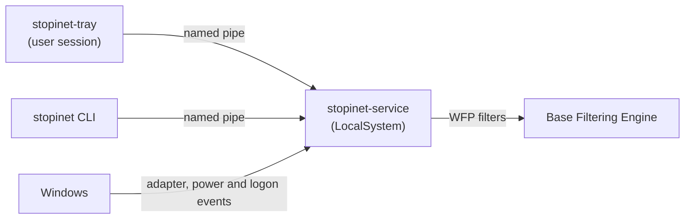

# stop-internet

English | [Русский](README.ru.md)

Fail-closed kill switch for TUN-based VPN clients on Windows, built on the
Windows Filtering Platform (WFP).

> **Status:** early development. The firewall engine and the Windows service
> work and passed the manual tests; the tray icon and mode switching are
> written and being tested by hand. Not ready for daily use.

## Why

A TUN-based VPN client routes traffic into its virtual adapter, but nothing
stops applications from using the physical adapter when the tunnel is not
there. Diagnostics with [Happ](https://www.happ.su) 4.3 on Windows showed two
real leaks:

- connections opened during a reconnect stayed on the physical adapter after
  the tunnel came back;
- a Windows system service kept a connection from boot outside the tunnel for
  the whole session.

Built-in protections of VPN cores are removed when the core exits, which is
exactly when they are needed.

## What it does

- While protection is on, applications reach the internet only through the
  tunnel. When the tunnel goes down, traffic is blocked at once.
- The routing of the VPN client keeps working: rule sets, direct rules and
  per-app exclusions are untouched.
- Apps excluded from the tunnel keep working when it drops, for example a
  game.
- Fail-closed: if the VPN client, its core or stop-internet crashes, or the
  machine reboots, the block stays.
- DNS to the router, IPv6 and Teredo outside the tunnel are blocked. Proxy
  mode without the tunnel lets system DNS out, so that the proxy can find
  its server.
- A tray icon shows the state and switches modes; turning protection off
  needs a UAC prompt and is time-limited.

## Modes

| Mode | Internet for applications | Icon |
|---|---|---|
| Tunnel only (default after every boot, wake-up and sign-in) | only through the tunnel | green / red |
| Proxy | through the tunnel or the VPN client's system proxy | green |
| Normal internet (15 min, 1 h or until reboot, sleep or sign-in) | unrestricted | grey |

## How it works



The service keeps a persistent baseline of WFP filters that blocks everything
except loopback, DHCP, IPv6 neighbor discovery and excluded apps. When the
tunnel adapter is up, it adds session filters for the tunnel adapter and for
the VPN daemon that carries the tunnel. The baseline survives reboots and
crashes; session filters vanish with the service.

See [docs/design.md](docs/design.md) for the threat model, the rule table and
the WFP mapping. The same documents, in English and Russian, are in the
[wiki](https://github.com/Morkoshka/stop-internet/wiki).

## Building

Requirements: Windows 10 or 11, Rust (MSVC toolchain).

```powershell
cargo build --release
cargo test
```

Dry run of the policy, without touching the system:

```powershell
cargo run -p stopinet-cli -- policy --config config/stopinet.example.toml --mode tunnel --tunnel down
```

Service, from an elevated terminal (see [docs/testing.md](docs/testing.md)
before the first run):

```powershell
.\target\release\stopinet.exe install --config <your config> --session-only
.\target\release\stopinet.exe status
.\target\release\stopinet.exe panic
.\target\release\stopinet.exe uninstall
```

`--session-only` keeps nothing persistent and is meant for testing; without
it the baseline survives reboots and service crashes. `panic` removes every
filter in an emergency. `install` also sets the tray icon to start at every
sign-in.

Modes, from the tray menu or from a terminal; `normal` needs an elevated
one:

```powershell
stopinet mode proxy
stopinet mode normal --minutes 15
stopinet mode tunnel
```

## Repository layout

| Path | Content |
|---|---|
| `crates/stopinet-core` | configuration, policy model, modes, pipe protocol |
| `crates/stopinet-win` | WFP engine, persistent baseline, tunnel adapter lookup, named pipe |
| `crates/stopinet-service` | Windows service |
| `crates/stopinet-tray` | tray icon |
| `crates/stopinet-cli` | `stopinet` command-line tool |
| `config/` | example configuration |
| `docs/` | design, manual tests |
| `tools/diag.ps1` | read-only, anonymized network diagnostics |
| `tools/blocked.ps1` | anonymized report of blocked connections (turns on auditing while it runs) |

## Roadmap

- [x] Design, configuration, policy model
- [x] WFP engine and CLI with automatic rollback
- [x] Tunnel monitor
- [x] Windows service: persistent and boot-time filters
- [ ] Tray icon, mode switching, UAC, timed normal mode (implemented, testing)
- [ ] Installer package and recovery guide
- [ ] Test checklist and releases

## License

[MIT](LICENSE)
