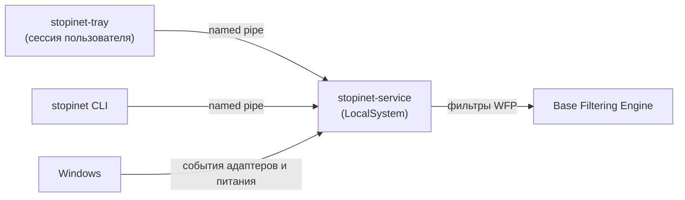

# stop-internet

[English](README.md) | Русский

Kill switch для VPN-клиентов с TUN-адаптером под Windows. Работает по
принципу fail-closed: при любом сбое интернет блокируется, а не открывается.
Построен на Windows Filtering Platform (WFP).

> **Статус:** ранняя разработка. Движок фильтров и служба Windows написаны и
> проходят ручную проверку; следующий шаг — значок в трее. Для ежедневного
> использования пока не готов.

## Зачем

VPN-клиент с TUN направляет трафик в свой виртуальный адаптер, но ничто не
мешает приложениям выйти через физический адаптер, когда туннеля нет.
Диагностика с [Happ](https://www.happ.su) 4.3 под Windows показала две
реальные утечки:

- соединения, открытые во время переподключения, остались на физическом
  адаптере и после возвращения туннеля;
- системная служба Windows держала соединение с момента загрузки мимо туннеля
  всю сессию.

Встроенная защита VPN-ядер снимается, когда ядро завершается, то есть именно
тогда, когда она нужнее всего.

## Что делает

- Пока защита включена, приложения выходят в интернет только через туннель.
  Туннель упал — трафик сразу блокируется.
- Маршрутизация VPN-клиента работает как раньше: наборы правил, прямые
  правила и исключения по приложениям не затрагиваются.
- Приложения, исключённые из туннеля, продолжают работать, когда он падает.
  Например, игра.
- Fail-closed: если упадёт VPN-клиент, его ядро или сам stop-internet, или
  компьютер перезагрузится, блокировка остаётся.
- DNS на роутер, IPv6 и Teredo мимо туннеля закрыты.
- Значок в трее показывает состояние и переключает режимы. Выключение
  защиты — только через UAC и на ограниченное время.

## Режимы

| Режим | Интернет для приложений | Значок |
|---|---|---|
| Только туннель (по умолчанию после каждой загрузки и выхода из сна) | только через туннель | зелёный / красный |
| Прокси | через туннель или системный прокси VPN-клиента | зелёный / красный |
| Обычный интернет (15 мин, 1 ч или до перезагрузки) | без ограничений | серый |

## Как устроен



Служба держит постоянный базовый набор фильтров WFP: он блокирует всё, кроме
loopback, DHCP, IPv6 Neighbor Discovery и приложений-исключений. Когда TUN-
адаптер поднят, служба добавляет временные фильтры для него и для демона
VPN-клиента, который несёт туннель. Базовый набор переживает перезагрузку и
сбои, временные фильтры исчезают вместе со службой.

Модель угроз, таблица правил и устройство фильтров WFP — в
[docs/design.ru.md](docs/design.ru.md).

## Сборка

Нужны Windows 10 или 11 и Rust (MSVC).

```powershell
cargo build --release
cargo test
```

Посмотреть правила без изменений в системе:

```powershell
cargo run -p stopinet-cli -- policy --config config/stopinet.example.toml --mode tunnel --tunnel down
```

Служба, из терминала администратора (перед первым запуском прочитайте
[docs/testing.ru.md](docs/testing.ru.md)):

```powershell
.\target\release\stopinet.exe install --config <ваш конфиг> --session-only
.\target\release\stopinet.exe status
.\target\release\stopinet.exe panic
.\target\release\stopinet.exe uninstall
```

С `--session-only` служба не оставляет ничего постоянного, это режим для
проверки. Без него базовый набор переживает перезагрузку и сбой службы.
`panic` в экстренном случае снимает все фильтры.

## Структура

| Путь | Что там |
|---|---|
| `crates/stopinet-core` | конфигурация и модель правил |
| `crates/stopinet-win` | движок WFP, постоянный базовый набор, поиск TUN-адаптера |
| `crates/stopinet-service` | служба Windows |
| `crates/stopinet-tray` | значок в трее (в планах) |
| `crates/stopinet-cli` | утилита командной строки `stopinet` |
| `config/` | пример конфигурации |
| `docs/` | архитектура, ручные тесты |
| `tools/diag.ps1` | диагностика сети: только чтение, данные обезличены |

## План

- [x] Архитектура, конфигурация, модель правил
- [x] Движок WFP и CLI с автоматическим откатом
- [x] Слежение за туннелем
- [ ] Служба Windows: постоянные и boot-time фильтры (написана, проверяется)
- [ ] Значок в трее, переключение режимов, UAC, «обычный интернет» на время
- [ ] Установочный пакет и инструкция по восстановлению
- [ ] Чек-лист тестов и релизы

## Лицензия

[MIT](LICENSE)
