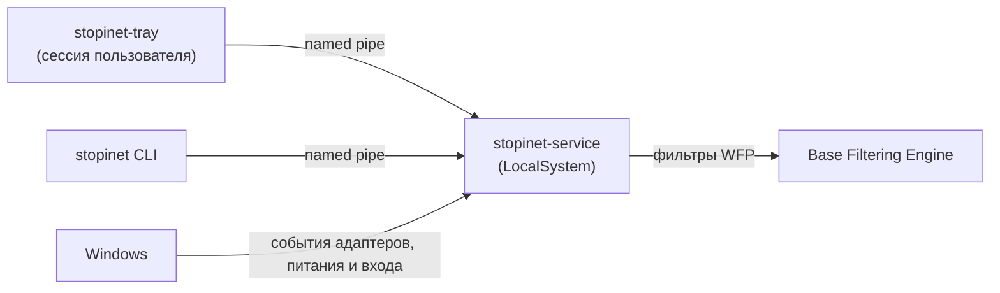

<div align="center">


# stop-internet

**Kill switch для VPN-клиентов с TUN-адаптером под Windows, по принципу fail-closed**

Мимо туннеля в интернет не уходит ничего: ни до подключения VPN, ни во
время переподключения, ни после его падения.

[](https://github.com/Morkoshka/stop-internet/actions/workflows/ci.yml)
[](LICENSE)


[](https://github.com/Morkoshka/stop-internet/wiki)

[English](README.md) · Русский

</div>

> [!WARNING]
> Ранняя разработка. Все части работают и прошли ручную проверку на
> реальной машине, но установщика и готовых сборок пока нет: собирать нужно
> из исходников.

## Зачем

VPN-клиент с TUN направляет трафик в свой виртуальный адаптер, но ничто не
мешает приложениям выйти через физический адаптер, пока туннеля нет.
Диагностика с [Happ](https://www.happ.su) 4.3 под Windows показала две
реальные утечки:

- соединения, открытые во время переподключения, остались на физическом
  адаптере и после возвращения туннеля;
- системная служба Windows держала соединение с момента загрузки мимо
  туннеля всю сессию.

Встроенная защита VPN-ядер снимается, когда ядро завершается, то есть
именно тогда, когда она нужнее всего.

## Возможности

- **Туннель или ничего.** Пока защита включена, приложения выходят в
  интернет только через туннель. Туннель упал — трафик сразу блокируется.
- **Fail-closed.** Если упадёт VPN-клиент, его ядро или сам stop-internet,
  или компьютер перезагрузится, блокировка остаётся: базовый набор правил
  живёт в самой Windows Filtering Platform.
- **VPN-клиент по-прежнему главный.** Наборы правил, прямые правила и
  исключения по приложениям работают как раньше. Приложения, исключённые из
  туннеля, например игра, продолжают работать, когда он падает.
- **Без утечек сбоку.** DNS на роутер, IPv6 и Teredo мимо туннеля закрыты.
- **Значок в трее.** Сразу видно состояние, режимы переключаются из меню.
  За VPN-клиентом он следит сам: «Прокси», пока клиент работает системным
  прокси, иначе «только туннель».
- **Выключить можно только намеренно.** Выключение защиты — через запрос
  UAC, на 15 минут, час или до перезагрузки, сна или входа, а потом она
  включается сама.

## Режимы

| Значок | Режим | Интернет для приложений |
|:-:|---|---|
|   | **Только туннель**: по умолчанию после каждой загрузки, выхода из сна и входа | только через туннель; без туннеля закрыт |
|  | **Прокси**: для VPN-клиента в режиме системного прокси, без TUN | через туннель или локальный прокси клиента |
|  | **Обычный интернет**: 15 мин, 1 ч или до перезагрузки, сна или входа | без ограничений |

Значок зелёный, пока интернет работает через VPN, красный, пока он
заблокирован (нет туннеля или не работает служба), и серый, пока защита
выключена. Знаки на щите тоже разные, так что состояния различимы и без
цвета.

Меню значка говорит на языке интерфейса Windows, по-русски или по-английски:

```text
Только туннель
интернет через VPN
──────────────────────
✓ Автоматически                выбирать режим по системному прокси
● Только туннель
  Прокси
  Обычный интернет  ›          на 15 мин, на 1 ч, до перезагрузки
──────────────────────
  Журнал службы
  Закрыть значок
```

## Как устроен



Служба держит постоянный базовый набор фильтров WFP, который блокирует всё,
кроме loopback, DHCP, IPv6 Neighbor Discovery и приложений-исключений. Пока
TUN-адаптер поднят, она добавляет сеансовые фильтры для туннеля и для
демона VPN, который его обслуживает. Базовый набор переживает перезагрузку
и сбои, сеансовые фильтры исчезают вместе со службой. Собственный подслой с
наивысшим весом не даёт разрешающим правилам брандмауэра Windows и других
программ открыть дыру.

В [описании архитектуры](docs/design.ru.md) — модель угроз, таблица правил,
устройство фильтров WFP и причины каждого решения.

## Как начать

**Нужно:** Windows 10 или 11, [Rust](https://rustup.rs) с набором MSVC и
PowerShell от имени администратора для всего, что ставит фильтры.

1. Собрать и прогнать тесты:

   ```powershell
   cargo build --release
   cargo test
   ```

2. Скопировать [`config/stopinet.example.toml`](config/stopinet.example.toml)
   в `config/stopinet.local.toml` (git его не видит) и вписать свой
   VPN-клиент: TUN-адаптер, его процессы и приложения-исключения. Пример
   настроен на Happ. Посмотреть правила, ничего не меняя в системе:

   ```powershell
   .\target\release\stopinet.exe policy --config config\stopinet.local.toml --mode tunnel --tunnel down
   ```

3. Попробовать правила две минуты, потом они снимутся сами:

   ```powershell
   .\target\release\stopinet.exe trial --config config\stopinet.local.toml
   ```

4. Установить. С `--session-only` не остаётся ничего постоянного: после
   перезагрузки или остановки службы машина такая же, как была. Для
   постоянного базового набора запустить `install` ещё раз без этого
   ключа:

   ```powershell
   .\target\release\stopinet.exe install --config config\stopinet.local.toml --session-only
   ```

   Программы ставятся в `C:\Program Files\stop-internet`, конфигурация — в
   `C:\ProgramData\stop-internet`, значок в трее запускается при каждом
   входе.

> [!CAUTION]
> Держите выход под рукой. `stopinet panic` останавливает службу и снимает
> все фильтры, включая постоянные; сеть для этого не нужна. Защита
> вернётся, когда служба запустится снова. Прежде чем полагаться на
> stop-internet, пройдите [ручные тесты](docs/testing.ru.md).

### Каждый день

Хватает значка в трее. Из терминала (`stopinet` — это
`C:\Program Files\stop-internet\stopinet.exe`, в `PATH` его нет):

```powershell
stopinet status                      # служба, режим, фильтры, туннель
stopinet mode proxy                  # или tunnel
stopinet mode normal --minutes 15    # только из терминала администратора
stopinet uninstall                   # конфигурация и журнал остаются
```

Пока в меню значка включено «Автоматически», трей возвращает защищённый
режим, который подходит к системному прокси.

## Документация

- **[Архитектура](docs/design.ru.md)**: модель угроз, режимы, правила,
  фильтры WFP, жизненный цикл и причины решений.
- **[Ручные тесты](docs/testing.ru.md)**: что проверить на реальной машине,
  по шагам.
- **[Вики](https://github.com/Morkoshka/stop-internet/wiki)**: те же
  документы на русском и английском.

<details>
<summary><b>Структура репозитория</b></summary>

| Путь | Что там |
|---|---|
| `crates/stopinet-core` | конфигурация, модель правил, режимы, протокол канала; без unsafe-кода |
| `crates/stopinet-win` | движок WFP, постоянный базовый набор, поиск TUN-адаптера, named pipe |
| `crates/stopinet-service` | служба Windows |
| `crates/stopinet-tray` | значок в трее |
| `crates/stopinet-cli` | утилита командной строки `stopinet` |
| `config/` | пример конфигурации |
| `docs/` | архитектура, ручные тесты, картинки |
| `tools/diag.ps1` | диагностика сети: только чтение, данные обезличены |
| `tools/blocked.ps1` | обезличенный отчёт о заблокированных соединениях (на время работы включает аудит) |

</details>

## План

- [x] Архитектура, конфигурация, модель правил
- [x] Движок WFP и CLI с автоматическим откатом
- [x] Слежение за туннелем
- [x] Служба Windows: постоянные и boot-time фильтры
- [x] Значок в трее, переключение режимов, UAC, «обычный интернет» на время, автоматический выбор по системному прокси
- [ ] Установочный пакет и инструкция по восстановлению
- [ ] Полный чек-лист тестов и релизы

## Лицензия

[MIT](LICENSE)
