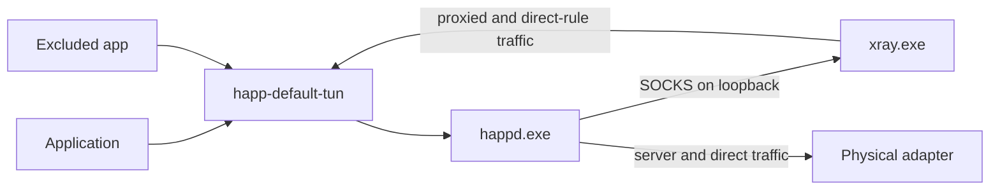

# Design

This document describes how stop-internet works and why it is built this
way. It is the reference for the implementation; the README is the short
version.

## Goal

A Windows utility that keeps a TUN-based VPN client **fail-closed**. While
protection is on, applications can reach the internet only through the
tunnel. When the tunnel disappears, the VPN client crashes or stop-internet
itself crashes, traffic stays blocked.

The routing of the VPN client must keep working exactly as configured there:
direct and proxy rules, rule sets, per-app exclusions.

The reference client is [Happ](https://www.happ.su) 4.3 for Windows (Xray
core). stop-internet is not tied to it: the tunnel adapter and the client
processes come from the configuration.

## Threat model

stop-internet protects against:

- applications sending traffic past the tunnel before it comes up (boot,
  reconnect) or after it went down;
- connections opened while the tunnel was down. They stay on the physical
  adapter even after the tunnel returns: with Happ 4.3, browser, chat and
  music clients kept such connections after a reconnect;
- long-lived connections opened before the tunnel, for example the Windows
  push notification service, which otherwise stays outside the tunnel for the
  whole session;
- DNS queries to the router or the ISP resolver, IPv6 and Teredo outside the
  tunnel;
- the VPN client, its core or stop-internet crashing;
- forgetting that protection is off: "normal internet" is time-limited and
  every boot and wake-up returns to the protected mode.

It does not protect against:

- routing decisions of the VPN client itself. What the client sends directly
  (direct rules, excluded apps, "proxy only selected apps") goes directly, by
  design. stop-internet guarantees only that nothing bypasses the client;
- software running as administrator: it can stop the service or remove the
  filters. Stopping is still fail-closed, removal is not;
- anything inside the tunnel, which is the job of the VPN.

## How Happ 4.3 routes traffic on Windows

Observed with anonymized diagnostics ([`tools/diag.ps1`](../tools/diag.ps1)):

- `HappService` (`happd.exe`, LocalSystem) creates the Wintun adapter
  `happ-default-tun` and runs a user-space TCP/IP stack on it.
- `xray.exe` is the proxy core, started by the Happ UI. It listens for SOCKS
  and HTTP on loopback.
- Adapter name, GUID and index stay the same across reconnects. When Happ
  disconnects, the adapter is removed.

| Traffic | Path |
|---|---|
| Ordinary app | TUN → happd → xray → TUN again → happd → physical adapter → VPN server |
| Direct rule (rule sets) | xray → TUN → happd → physical adapter |
| App excluded in Happ | TUN → happd → physical adapter, xray not involved, UDP included |
| System proxy mode, no TUN | app → loopback proxy → xray → physical adapter |
| Happ itself | happd keeps one connection of its own on the physical adapter |

So with TUN, **only `happd.exe` needs the physical adapter**. In system proxy
mode only `xray.exe` does.

## Modes

| Mode | Applications | VPN client on the physical adapter | Tray icon |
|---|---|---|---|
| Tunnel only (default) | through the tunnel | tunnel daemon, only while the tunnel is up | green / red |
| Proxy | through the tunnel or the client's local proxy | tunnel daemon while the tunnel is up; proxy core always | green / red |
| Normal internet | anything | anything | grey |

In every protected mode, applications from the `direct` list may use the
physical adapter (see [Excluded apps](#excluded-apps-when-the-tunnel-drops)),
and loopback, DHCP and IPv6 neighbor discovery are allowed.

"Normal internet" lowers protection, so switching to it needs a UAC prompt
and lasts 15 minutes, an hour or until reboot. The protected mode returns on
every service start, boot (including Fast Startup) and wake-up from sleep or
hibernation.

## Policy

`stopinet-core` builds an ordered list of abstract rules from the
configuration, the mode and the tunnel state (`Policy::build`). The service
maps each rule to WFP filters. Run `stopinet policy` to see the result for any
mode and state without touching the system.

| # | Rule | Scope | When |
|---|---|---|---|
| 1 | permit all traffic | session | normal internet |
| 2 | permit traffic on the tunnel adapter | session | protected mode, tunnel up |
| 3 | permit tunnel daemon (`happd.exe`) | session | protected mode, tunnel up |
| 4 | permit proxy core (`xray.exe`) | session | proxy mode |
| 5 | permit loopback | persistent | always |
| 6 | permit DHCP and DHCPv6 | persistent | always |
| 7 | permit IPv6 neighbor discovery | persistent | always |
| 8 | permit apps from the `direct` list | persistent | always |
| 9 | permit local network, DNS excluded | persistent | if `allow_lan` |
| 10 | block everything | persistent | always |

Persistent rules never depend on the mode or the tunnel. They are what the
Base Filtering Engine enforces by itself after a reboot or a service crash, so
they always form the safe baseline. A unit test checks this invariant for
every mode and state.

### Mapping to WFP

- One provider and one sublayer with the highest weight, both owned by
  stop-internet. Earlier rules get higher filter weights; the first matching
  filter in the sublayer decides.
- WFP arbitration lets a block in any sublayer override permits from other
  sublayers. Allow rules of Windows Firewall or other software cannot open
  holes in the baseline.
- Layers: `ALE_AUTH_CONNECT` and `ALE_AUTH_RECV_ACCEPT` for IPv4 and IPv6.
  Forwarded traffic (hotspot, Hyper-V NAT) is blocked by "block everything".
- Conditions:

| Matcher | WFP condition |
|---|---|
| Loopback | `FWPM_CONDITION_FLAGS` has `FWP_CONDITION_FLAG_IS_LOOPBACK` |
| DHCP | UDP, local port 68 / remote 67, local 546 / remote 547 |
| Neighbor discovery | ICMPv6 type 133 to 137 |
| Tunnel adapter | `FWPM_CONDITION_IP_LOCAL_INTERFACE` equals the adapter LUID |
| App | `FWPM_CONDITION_ALE_APP_ID` from `FwpmGetAppIdFromFileName0` |
| Local network | `FWPM_CONDITION_IP_REMOTE_ADDRESS` in private, link-local and multicast ranges, remote port not 53 |

- Session rules live in a dynamic WFP session of the service and vanish with
  it. Persistent rules use `FWPM_FILTER_FLAG_PERSISTENT`; boot-time copies
  (`FWPM_FILTER_FLAG_BOOTTIME`) cover the time before the Base Filtering
  Engine starts.
- Every change of state is applied in one WFP transaction, so there is no
  moment without a rule set.

## Lifecycle

- **Boot.** Boot-time filters block until the Base Filtering Engine starts,
  then the persistent baseline takes over. The service starts in "tunnel
  only".
- **Tunnel up or down.** The service listens to interface change
  notifications (`NotifyIpInterfaceChange`) and rechecks periodically as a
  safety net. On a change it rebuilds the session rules. The tunnel is "up"
  when an adapter with the configured alias and driver exists and is
  operational.
- **Switching to a protected mode.** Adding filters at ALE layers makes
  Windows re-authorize existing connections, so direct connections opened in
  normal mode are cut. To be verified by tests.
- **Service crash.** The dynamic session closes, session rules disappear, the
  baseline stays. The service control manager restarts the service.
- **Uninstall and emergency.** `stopinet uninstall` and `stopinet panic`
  remove every object of the stop-internet provider, persistent ones
  included. Recovery from Safe Mode is documented with the installer.

## Excluded apps when the tunnel drops

Apps in the `direct` list are permitted on any interface, in every protected
mode, persistently. While the tunnel is up, Windows routes them into the
tunnel and the VPN client sends them out directly. When the tunnel goes away,
they go out directly by themselves and are still permitted. A game excluded
from the tunnel therefore keeps its network access.

Limits:

- Whether a running session survives the switch depends on the application.
  The path changes from "through the VPN daemon" to "directly", so the source
  port seen by the server changes. TCP connections are reset; UDP sessions
  often recover. stop-internet adds no break of its own.
- While the tunnel is down, the system DNS resolver stays blocked, otherwise
  the domains of all applications would leak. Excluded apps can keep existing
  connections but cannot resolve new names until the tunnel returns.
- A game may depend on its platform client (for example Steam) for its
  session. Such a client has to be in the `direct` list too.

## Components

| Component | Runs as | Role |
|---|---|---|
| `stopinet-core` | library | configuration, policy model; no unsafe code, no system calls |
| `stopinet-service` | LocalSystem service | WFP filters, tunnel and power events, named pipe server |
| `stopinet-tray` | user session | status icon, menu in Russian, notifications |
| `stopinet` | CLI | status, mode, install, uninstall, panic, policy dry run |

- The tray and the CLI talk to the service over a named pipe. Its security
  descriptor admits SYSTEM, Administrators and the interactive user.
  Requests that lower protection need an elevated client token, which the
  tray obtains with a UAC prompt.
- The configuration lives in `%ProgramData%\stop-internet\config.toml` and is
  writable by administrators only.
- Logs record events (mode changes, tunnel up and down, errors), never remote
  addresses.

## Decisions

- **WFP instead of Windows Firewall rules.** Windows Firewall has dozens of
  built-in allow rules, and other software adds more; with a default
  outbound block each of them is a hole. Its rules also depend on the network
  profile, and nothing would switch them when the tunnel changes. A WFP
  sublayer of our own gives precedence over other permits, persistence across
  reboots and per-interface conditions. WireGuard for Windows and Mullvad use
  the same approach.
- **Rust.** Filtering happens in the Windows kernel, so the language does not
  affect network speed. Rust gives a small native service without a runtime
  or garbage collector, memory safety, and typed Windows API bindings from
  Microsoft's `windows` crate.
- **No tunnel health probes.** A tunnel that is up but broken passes nothing,
  so it is already safe. Health is a possible future status indicator, not a
  security feature.

## Testing

- `stopinet-core` has unit tests for the configuration and the policy
  invariants. They run in CI.
- Anything that installs filters or services is tested manually by the owner
  of the machine, following a written checklist: capture traffic on the
  physical adapter with `pktmon`, read WFP audit events (5157), and go
  through the scenarios: kill the client and its core, disconnect the tunnel,
  pull the cable, sleep and wake, reboot, kill the service, IPv6, DNS, UDP and
  QUIC, an excluded app before and after the tunnel drops.
- During development filters are session-only and roll back automatically
  after a timeout unless confirmed, so a mistake cannot leave the machine
  offline.

## Privacy

- Diagnostics are anonymized while they are collected: public addresses
  become labels, user and computer names become placeholders, URLs are
  removed.
- The repository contains no real addresses, keys or subscription links.
  Examples use documentation ranges (RFC 5737).
- Logs of stop-internet contain no remote addresses.

## Roadmap

1. Design, configuration and policy model. **Done.**
2. WFP engine and CLI with session filters and automatic rollback.
3. Tunnel monitor and mode switching.
4. Windows service: persistent and boot-time filters, crash and power
   handling.
5. Tray icon, named pipe, UAC and timed normal mode.
6. Installer, uninstaller, emergency removal.
7. Test checklist, release builds.
