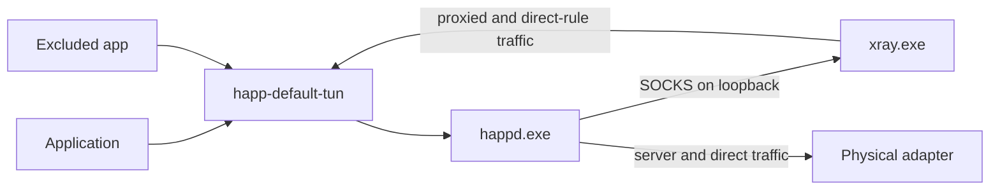
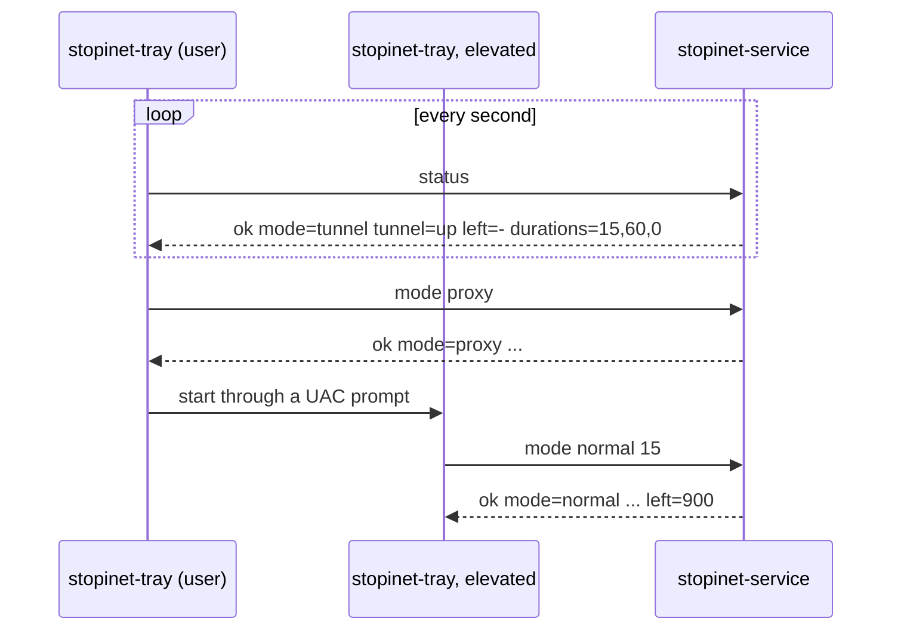

# Design

English | [Русский](design.ru.md)

This document describes how stop-internet works and why it is built this
way. It is the reference for the implementation; the README is the short
version.

## Goal

A Windows utility that keeps a TUN-based VPN client **fail-closed**. While
protection is on, applications can reach the internet only through the
tunnel. When the tunnel disappears, the VPN client crashes or stop-internet
itself crashes, traffic stays blocked.

The routing of the VPN client must keep working exactly as configured there:
direct and proxy rules, rule sets, per-app exclusions.

The reference client is [Happ](https://www.happ.su) 4.3 for Windows (Xray
core). stop-internet is not tied to it: the tunnel adapter and the client
processes come from the configuration.

## Threat model

stop-internet protects against:

- applications sending traffic past the tunnel before it comes up (boot,
  reconnect) or after it went down;
- connections opened while the tunnel was down. They stay on the physical
  adapter even after the tunnel returns: with Happ 4.3, browser, chat and
  music clients kept such connections after a reconnect;
- long-lived connections opened before the tunnel, for example the Windows
  push notification service, which otherwise stays outside the tunnel for the
  whole session;
- DNS queries to the router or the ISP resolver (except in proxy mode, see
  [Modes](#modes)), IPv6 and Teredo outside the tunnel;
- the VPN client, its core or stop-internet crashing;
- forgetting that protection is off: "normal internet" is time-limited and
  every boot, wake-up and user logon returns to the protected mode.

It does not protect against:

- routing decisions of the VPN client itself. What the client sends directly
  (direct rules, excluded apps, "proxy only selected apps") goes directly, by
  design. stop-internet guarantees only that nothing bypasses the client;
- software running as administrator: it can stop the service or remove the
  filters. Stopping is still fail-closed, removal is not;
- anything inside the tunnel, which is the job of the VPN.

## How Happ 4.3 routes traffic on Windows

Observed with anonymized diagnostics ([`tools/diag.ps1`](../tools/diag.ps1)):

- `HappService` (`happd.exe`, LocalSystem) creates the Wintun adapter
  `happ-default-tun` and runs a user-space TCP/IP stack on it.
- `xray.exe` is the proxy core, started by the Happ UI. It listens for SOCKS
  and HTTP on loopback.
- Adapter name, GUID and index stay the same across reconnects. When Happ
  disconnects, the adapter is removed.

| Traffic | Path |
|---|---|
| Ordinary app | TUN → happd → xray → TUN again → happd → physical adapter → VPN server |
| Direct rule (rule sets) | xray → TUN → happd → physical adapter |
| App excluded in Happ | TUN → happd → physical adapter, xray not involved, UDP included |
| System proxy mode, no TUN | app → loopback proxy → xray → physical adapter; xray finds the server through the system resolver |
| Happ itself | happd keeps one connection of its own on the physical adapter |
| Subscription updates | `Happ.exe` (the UI) connects directly, HTTPS; while connected this works through the rules for the tunnel |

So with TUN, **only `happd.exe` needs the physical adapter**. In system proxy
mode only `xray.exe` does, and the Windows DNS client for its DNS queries.
While Happ is disconnected, `Happ.exe` can update subscriptions only if it is
in the `direct` list; then the provider sees the subscription server and the
update checks of Happ.

## Modes

| Mode | Applications | VPN client on the physical adapter | Tray icon |
|---|---|---|---|
| Tunnel only (default) | through the tunnel | tunnel daemon, only while the tunnel is up | green / red |
| Proxy | through the tunnel or the client's local proxy | tunnel daemon while the tunnel is up; proxy core and DNS queries of the system resolver always | green |
| Normal internet | anything | anything | grey |

In every protected mode, applications from the `direct` list may use the
physical adapter (see [Excluded apps](#excluded-apps-when-the-tunnel-drops)),
and loopback, DHCP and IPv6 neighbor discovery are allowed. In proxy mode
the icon stays green with the tunnel down too: the proxy core may go out
directly either way, and whether it runs is not checked.

Without TUN the proxy core finds its server through the system resolver, so
proxy mode also lets the Windows DNS client (`svchost.exe`) send queries to
port 53. The router and the provider then see the names programs look up,
not their traffic: whatever does not go through the proxy stays blocked. The
browser does not look names up itself when it uses the proxy. Tunnel-only
mode keeps DNS closed while the tunnel is down.

"Normal internet" lowers protection, so switching to it needs an elevated
administrator, which the tray gets through a UAC prompt. It lasts as long as
chosen from `normal_mode.durations_min` (15 minutes, an hour or until reboot
by default) and then returns to "tunnel only". It also ends on every service
start, boot, wake-up from sleep or hibernation and user logon. Proxy mode
survives a wake-up and a logon; a service start always begins in "tunnel
only".

## Policy

`stopinet-core` builds an ordered list of abstract rules from the
configuration, the mode and the tunnel state (`Policy::build`). The service
maps each rule to WFP filters. Run `stopinet policy` to see the result for any
mode and state without touching the system.

| # | Rule | Scope | When |
|---|---|---|---|
| 1 | permit all traffic | session | normal internet |
| 2 | permit traffic on the tunnel adapter | session | protected mode, tunnel up |
| 3 | permit tunnel daemon (`happd.exe`) | session | protected mode, tunnel up |
| 4 | permit proxy core (`xray.exe`) | session | proxy mode |
| 5 | permit DNS queries of the Windows DNS client (`svchost.exe`, remote port 53, outbound) | session | proxy mode |
| 6 | permit loopback | persistent | always |
| 7 | permit DHCP and DHCPv6 | persistent | always |
| 8 | permit IPv6 neighbor discovery | persistent | always |
| 9 | permit apps from the `direct` list | persistent | always |
| 10 | permit local network, DNS excluded | persistent | if `allow_lan` |
| 11 | block everything | persistent | always |

Persistent rules never depend on the mode or the tunnel. They are what the
Base Filtering Engine enforces by itself after a reboot or a service crash, so
they always form the safe baseline. A unit test checks this invariant for
every mode and state.

### Mapping to WFP

- One provider and one sublayer with the highest weight, both owned by
  stop-internet. Earlier rules get higher filter weights; the first matching
  filter in the sublayer decides.
- WFP arbitration lets a block in any sublayer override permits from other
  sublayers. Allow rules of Windows Firewall or other software cannot open
  holes in the baseline.
- Layers: `ALE_AUTH_CONNECT` and `ALE_AUTH_RECV_ACCEPT` for IPv4 and IPv6.
  Forwarded traffic (hotspot, Hyper-V NAT) is blocked by "block everything".
- Conditions:

| Matcher | WFP condition |
|---|---|
| Loopback | `FWPM_CONDITION_FLAGS` has `FWP_CONDITION_FLAG_IS_LOOPBACK` |
| DHCP | UDP, local port 68 / remote 67, local 546 / remote 547 |
| Neighbor discovery | ICMPv6 type 133 to 137 |
| Tunnel adapter | `FWPM_CONDITION_IP_LOCAL_INTERFACE` equals the adapter LUID |
| App | `FWPM_CONDITION_ALE_APP_ID` from `FwpmGetAppIdFromFileName0` |
| Local network | `FWPM_CONDITION_IP_REMOTE_ADDRESS` in private, link-local and multicast ranges, remote port not 53 |

- Session rules live in a dynamic WFP session of the service and vanish with
  it. Persistent rules use `FWPM_FILTER_FLAG_PERSISTENT`; boot-time copies
  (`FWPM_FILTER_FLAG_BOOTTIME`) cover the time before the Base Filtering
  Engine starts.
- The provider and the sublayer are persistent, and the session filters of
  the service are added on top of them. The provider names no service on
  purpose: the Base Filtering Engine skips persistent objects of a provider
  whose service is not set to start automatically, and the baseline must
  hold even when the service is disabled.
- The persistent baseline is replaced in one transaction, the boot-time
  copies in a second one. The copies only matter between the start of the
  TCP/IP driver and the start of the Base Filtering Engine, so a failure to
  update them is logged and does not stop the service.
- Every change of state is applied in one WFP transaction, so there is no
  moment without a rule set.

## Lifecycle

- **Boot.** Boot-time filters block until the Base Filtering Engine starts,
  then the persistent baseline takes over. The service starts automatically
  after the Base Filtering Engine, in "tunnel only".
- **Service start.** The service loads the configuration, replaces the
  persistent baseline with the one built from it, opens its dynamic session
  and adds the session rules for the current tunnel state. Only then does it
  report "running". If any step fails, it exits with an error code and the
  previous baseline keeps blocking.
- **Tunnel up or down.** The service listens to interface change
  notifications (`NotifyIpInterfaceChange`) and rechecks every 2 seconds as a
  safety net. On a change it rebuilds the session rules. The tunnel is "up"
  when an adapter with the configured alias and driver exists and is
  operational.
- **Sleep and wake-up.** On `PBT_APMRESUMEAUTOMATIC`, sent on every wake-up
  from sleep or hibernation, "normal internet" ends and the tunnel is
  checked again. The protected modes stay as they were. In the manual tests
  a shutdown and power-on with Fast Startup enabled started the service
  anew, which ends "normal internet" as well.
- **User logon.** On `WTS_SESSION_LOGON` "normal internet" ends too. This
  covers a power-on with Fast Startup that resumes the service instead of
  starting it, and a sign-in after a sign-out or a switch of users.
- **Mode change.** A client asks over the named pipe (see
  [Tray icon and named pipe](#tray-icon-and-named-pipe)). The service
  carries out the request in its main loop and answers only when the new
  rules are in place. A timed "normal internet" is checked with the tunnel,
  every 2 seconds, so it ends at most that much late.
- **Switching to a protected mode.** Adding filters at ALE layers makes
  Windows re-authorize existing connections, so direct connections opened in
  normal mode are cut. Step C8 of the manual tests checks this.
- **Service stop or crash.** The dynamic session closes, session rules
  disappear, the baseline stays. After a crash or a failed start the service
  control manager restarts the service after 5, 10 and 30 seconds; the
  failure count resets after a day.
- **Uninstall and emergency.** `stopinet uninstall` and `stopinet panic`
  stop the service first, because its session filters go away only with its
  session, then remove every object of the stop-internet provider,
  persistent and boot-time ones included. `panic` keeps the service
  installed: protection returns when it starts again.
- **Session-only mode.** `stopinet install --session-only` starts the service
  with `--session-only`. It installs nothing persistent and keeps every rule,
  the baseline included, in its dynamic session, like a trial without a time
  limit. Stopping the service removes every filter. It is meant for the first
  tests of the service on a real machine.

## Tray icon and named pipe

**Named pipe.** `\\.\pipe\stopinet` belongs to the service:

- It is created with `FILE_FLAG_FIRST_PIPE_INSTANCE` and a limit of one
  instance, so no other process can serve the name while the service runs.
  Clients also check that the pipe belongs to the process of the running
  service (`GetNamedPipeServerProcessId` against the service manager).
- The security descriptor gives full access to SYSTEM and Administrators.
  Interactive users may read and write, but not create pipe instances
  (`FILE_CREATE_PIPE_INSTANCE` is part of `GENERIC_WRITE`, so they get
  `0x12019b` instead). Remote clients are rejected.
- Clients connect at the identification level. That lets the service read
  the client's token, but not act as the client.
- "Normal internet" is accepted only if the Administrators group is enabled
  in the client token: an elevated administrator or LocalSystem. In the
  filtered token of an administrator without UAC elevation the group is for
  deny only and does not count. Every other request is open to every
  client, since it keeps or raises protection.
- A connection carries one request line and one response line, each with a
  time limit, so a client that hangs blocks others for a few seconds at
  most. If the pipe cannot be created, the service logs it and keeps
  protecting.

| Request | Answer |
|---|---|
| `status` | `ok mode=<tunnel\|proxy\|normal> tunnel=<up\|down> left=<seconds\|reset\|-> durations=<minutes,...>` |
| `mode tunnel`, `mode proxy` | the same state line after the change |
| `mode normal <minutes>` | the same, or `refused not-elevated`; `0` minutes means until the next reboot, wake-up or logon |
| anything else | `refused bad-request` |

`refused unavailable` means the service did not carry out the request in
time, for example because it is stopping. Clients ignore keys they do not
know, so a newer service does not break an older tray.

**Tray icon.** `stopinet-tray.exe` runs in the session of the user, without
administrator rights:

- It asks the service for its state once a second and shows it in the icon
  and the tooltip. The icon is a shield with a white sign, so the states
  differ by shape as well as by color, also next to round icons of other
  programs: a green one with a check mark, a red one with a cross, a grey
  one with a dash. When the service cannot be asked, the icon is red and the
  tooltip says why: not installed, stopped, an older version without the
  pipe, or the pipe held by another program.
- The menu, in Russian, shows the state on two short lines, switches
  between "tunnel only" and proxy mode directly, offers "normal internet"
  for each duration of the configuration, opens the service log and closes
  the icon. Closing the icon does not change the protection.
- The menu opens with its left edge at the cursor and its bottom edge on
  the taskbar (beside it for a top or side taskbar, above the icon in the
  overflow area), so the taskbar never covers it. The cursor, the icon
  rectangle (`Shell_NotifyIconGetRect`) and the taskbar
  (`ABM_GETTASKBARPOS`) are all in physical pixels: the tray is per-monitor
  DPI aware.
- The menu is dark or light like the app theme in the Windows settings.
  Win32 has no documented API for dark popup menus, so the tray uses the
  functions of `uxtheme.dll` that Windows itself uses, by ordinal, and only
  on Windows 10 1903 or later, where their signatures are known. Without
  them the menu stays light.
- For "normal internet" the tray starts itself again through a UAC prompt,
  as `stopinet-tray.exe --normal <minutes>`. That instance only sends the
  request and shows a message if it fails. It is the tray and not
  `stopinet.exe`, so that no console window opens.
- There are no notifications: the state is in the icon, and with "do not
  disturb" on they would go unseen anyway. They can be added later.
- `stopinet install` adds the tray to
  `HKLM\SOFTWARE\Microsoft\Windows\CurrentVersion\Run`, so it starts at every
  sign-in of every user, and starts it in the current session through
  Explorer, which runs without elevation. The entry can be turned off in Task
  Manager under Startup apps. `install` and `uninstall` close running icons
  first, because a running program cannot be replaced or deleted.
- One icon per session (a mutex in the `Local\` namespace). The icon comes
  back when Explorer restarts (`TaskbarCreated`). The icons are drawn in
  code, so the repository holds no images.

## Excluded apps when the tunnel drops

Apps in the `direct` list are permitted on any interface, in every protected
mode, persistently. While the tunnel is up, Windows routes them into the
tunnel and the VPN client sends them out directly. When the tunnel goes away,
they go out directly by themselves and are still permitted. A game excluded
from the tunnel therefore keeps its network access.

Limits:

- Whether a running session survives the switch depends on the application.
  The path changes from "through the VPN daemon" to "directly", so the source
  port seen by the server changes. TCP connections are reset; UDP sessions
  often recover. stop-internet adds no break of its own.
- While the tunnel is down, the system DNS resolver stays blocked, otherwise
  the domains of all applications would leak. Excluded apps can keep existing
  connections but cannot resolve new names until the tunnel returns.
- A game may depend on its platform client (for example Steam) for its
  session. Such a client has to be in the `direct` list too.
- While Happ is connected, it carries excluded apps through `happd.exe` and
  its user-space network stack. So they lose the network when the service
  stops while the tunnel is up (`happd.exe` is permitted only by session
  rules), and their ping is higher than with Happ disconnected. The WFP
  filters of stop-internet work in the kernel and add no noticeable delay.

## Components

| Component | Runs as | Role |
|---|---|---|
| `stopinet-core` | library | configuration, policy model, mode selection with its timer, pipe protocol; no unsafe code, no system calls |
| `stopinet-win` | library | WFP engine, persistent baseline, adapter lookup and notifications, named pipe, tray autostart; all unsafe code of the service and the CLI |
| `stopinet-service` | LocalSystem service | WFP filters, tunnel, power and logon events, named pipe server |
| `stopinet-tray` | user session | status icon, menu in Russian, mode switching; its window code is its own unsafe code |
| `stopinet` | CLI | policy dry run, trial, install, uninstall, panic, status, mode |

- The tray and the CLI talk to the service over a named pipe. Its security
  descriptor admits SYSTEM, Administrators and the interactive user.
  Requests that lower protection need an elevated client token, which the
  tray obtains with a UAC prompt. See
  [Tray icon and named pipe](#tray-icon-and-named-pipe).
- The programs live in `%ProgramFiles%\stop-internet`, so only
  administrators can replace the binary of a LocalSystem service, or the
  tray that every user starts at sign-in.
- The configuration lives in `%ProgramData%\stop-internet\config.toml`. The
  folder gets its own permissions: full control for SYSTEM and
  Administrators, read for Users, nothing inherited from `ProgramData`.
- The service log, `%ProgramData%\stop-internet\service.log`, records events
  (start, stop, mode changes, tunnel up and down, errors), never remote
  addresses. Over 1 MiB it starts over and keeps one previous file.

## Decisions

- **WFP instead of Windows Firewall rules.** Windows Firewall has dozens of
  built-in allow rules, and other software adds more; with a default
  outbound block each of them is a hole. Its rules also depend on the network
  profile, and nothing would switch them when the tunnel changes. A WFP
  sublayer of our own gives precedence over other permits, persistence across
  reboots and per-interface conditions. WireGuard for Windows and Mullvad use
  the same approach.
- **Rust.** Filtering happens in the Windows kernel, so the language does not
  affect network speed. Rust gives a small native service without a runtime
  or garbage collector, memory safety, and typed Windows API bindings from
  Microsoft's `windows` crate.
- **No tunnel health probes.** A tunnel that is up but broken passes nothing,
  so it is already safe. Health is a possible future status indicator, not a
  security feature.

## Testing

- Unit tests cover the configuration, the policy invariants, the filter
  plan (including "the persistent part is the same in every state"), the
  tunnel observation, the event loop of the service, the mode selection
  with its timer and resets, the pipe protocol, a round trip over a real
  named pipe, and the icons and menu of the tray. They run in CI.
- Anything that installs filters or services is tested manually by the owner
  of the machine, following a written checklist
  ([`docs/testing.md`](testing.md)): capture traffic on the
  physical adapter with `pktmon`, read WFP audit events (5157), and go
  through the scenarios: kill the client and its core, disconnect the tunnel,
  pull the cable, sleep and wake, reboot, kill the service, IPv6, DNS, UDP and
  QUIC, an excluded app before and after the tunnel drops.
- New rules are tried with `stopinet trial` first: session filters that
  roll back after a timeout. The service is tested in session-only mode
  before the persistent baseline, and `stopinet panic` is checked right after
  the first persistent install, before any reboot.

## Privacy

- Diagnostics are anonymized while they are collected: public addresses
  become labels, user and computer names become placeholders, URLs are
  removed.
- The repository contains no real addresses, keys or subscription links.
  Examples use documentation ranges (RFC 5737).
- Logs of stop-internet contain no remote addresses.

## Roadmap

1. Design, configuration and policy model. **Done.**
2. WFP engine and CLI with session filters and automatic rollback. **Done.**
3. Tunnel monitor. **Done.** Mode switching moved to step 5, it needs the
   named pipe.
4. Windows service: persistent and boot-time filters, crash and power
   handling; `install`, `uninstall`, `panic`, `status`. **Done.**
5. Tray icon, named pipe, mode switching, UAC and timed normal mode.
   **Written**; the manual tests (part C of the checklist) are pending.
6. Installer package and a recovery guide.
7. Full test checklist, release builds.
