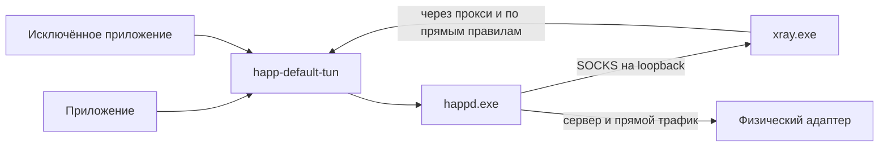
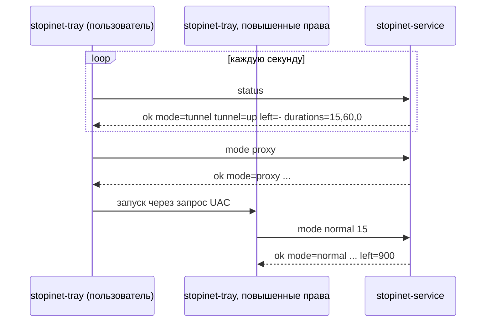

# Архитектура

[English](design.md) | Русский

Здесь описано, как работает stop-internet и почему он устроен именно так.
Это опорный документ для реализации; README — его короткая версия.

## Цель

Утилита для Windows, которая делает VPN-клиент с TUN-адаптером
**fail-closed**. Пока защита включена, приложения выходят в интернет только
через туннель. Если туннель пропал, упал VPN-клиент или сам stop-internet,
трафик остаётся заблокированным.

Маршрутизация VPN-клиента должна работать ровно так, как в нём настроено:
прямые и проксируемые правила, наборы правил, исключения по приложениям.

Эталонный клиент — [Happ](https://www.happ.su) 4.3 для Windows (ядро Xray).
stop-internet к нему не привязан: TUN-адаптер и процессы клиента задаются в
конфигурации.

## Модель угроз

stop-internet защищает от того, что:

- приложения отправляют трафик мимо туннеля до того, как он поднялся
  (загрузка, переподключение), или после того, как он упал;
- соединения, открытые без туннеля, остаются на физическом адаптере и после
  его возвращения: с Happ 4.3 так вели себя браузер, мессенджер и
  музыкальный клиент после переподключения;
- долгоживущие соединения, открытые раньше туннеля, например служба
  push-уведомлений Windows, иначе всю сессию идут мимо туннеля;
- DNS-запросы уходят на роутер или DNS провайдера (кроме режима «Прокси»,
  см. [Режимы](#режимы)), IPv6 и Teredo — мимо туннеля;
- падает VPN-клиент, его ядро или stop-internet;
- пользователь забывает, что защита выключена: «обычный интернет» включается
  на время, а каждая загрузка, выход из сна и вход пользователя возвращают
  защищённый режим.

От чего не защищает:

- от решений маршрутизации самого VPN-клиента. То, что клиент отправляет
  напрямую (прямые правила, исключённые приложения, «проксировать только
  выбранные приложения»), идёт напрямую, так задумано. stop-internet
  гарантирует только, что ничего не обходит клиент;
- от программ с правами администратора: они могут остановить службу или
  удалить фильтры. Остановка всё равно fail-closed, удаление — нет;
- от того, что происходит внутри туннеля: это задача VPN.

## Как Happ 4.3 направляет трафик в Windows

Наблюдения сделаны обезличенной диагностикой
([`tools/diag.ps1`](../tools/diag.ps1)):

- `HappService` (`happd.exe`, LocalSystem) создаёт Wintun-адаптер
  `happ-default-tun` и держит на нём свой стек TCP/IP в пользовательском
  режиме.
- `xray.exe` — ядро прокси, его запускает интерфейс Happ. Слушает SOCKS и
  HTTP на loopback.
- Имя, GUID и индекс адаптера не меняются при переподключении. Когда Happ
  отключается, адаптер удаляется.

| Трафик | Путь |
|---|---|
| Обычное приложение | TUN → happd → xray → снова TUN → happd → физический адаптер → VPN-сервер |
| Прямое правило (наборы правил) | xray → TUN → happd → физический адаптер |
| Приложение, исключённое в Happ | TUN → happd → физический адаптер, без xray, UDP тоже |
| Режим системного прокси, без TUN | приложение → прокси на loopback → xray → физический адаптер; адрес сервера xray узнаёт через системный DNS |
| Сам Happ | у happd есть своё постоянное соединение через физический адаптер |
| Обновление подписок | `Happ.exe` (интерфейс) подключается напрямую по HTTPS; при подключённом Happ это работает благодаря правилам для туннеля |

Итак, с TUN **физический адаптер нужен только `happd.exe`**. В режиме
системного прокси — только `xray.exe` и, для его DNS-запросов, DNS-клиенту
Windows. При отключённом Happ `Happ.exe` может обновить подписки, только если
он в списке `direct`; тогда провайдер видит сервер подписок и проверки
обновлений Happ.

## Режимы

| Режим | Приложения | VPN-клиент на физическом адаптере | Значок в трее |
|---|---|---|---|
| Только туннель (по умолчанию) | через туннель | демон туннеля, только пока туннель поднят | зелёный / красный |
| Прокси | через туннель или локальный прокси клиента | демон туннеля, пока туннель поднят; ядро прокси и DNS-запросы системного DNS-клиента всегда | зелёный |
| Обычный интернет | что угодно | что угодно | серый |

Во всех защищённых режимах приложения из списка `direct` могут работать
через физический адаптер (см.
[Исключённые приложения](#исключённые-приложения-при-падении-туннеля)), а
loopback, DHCP и IPv6 Neighbor Discovery разрешены. В режиме прокси значок
остаётся зелёным и без туннеля: ядро прокси может выходить напрямую в любом
случае, а работает ли оно, не проверяется.

Без TUN ядро прокси узнаёт адрес своего сервера через системный DNS, поэтому
режим «Прокси», пока туннеля нет, ещё пускает DNS-клиент Windows
(`svchost.exe`) на порт 53. Роутер и провайдер при этом видят имена, которые
ищут программы, но не их трафик: всё, что идёт не через прокси, остаётся
заблокированным. Браузер, который работает через прокси, сам имена не ищет.
При поднятом туннеле DNS идёт только через туннель: Windows может отправить
запрос сразу на все адаптеры, и это правило выпустило бы имена на роутер. В
режиме «Только туннель» DNS без туннеля по-прежнему закрыт.

«Обычный интернет» снижает защиту, поэтому включить его может только
администратор с повышенными правами: трей получает их через запрос UAC. Он
длится выбранное время из `normal_mode.durations_min` (по умолчанию
15 минут, час или до перезагрузки), затем возвращается «только туннель».
Ещё он выключается при каждом запуске службы, загрузке, выходе из сна или
гибернации и входе пользователя. Режим «Прокси» переживает выход из сна и
вход пользователя; запуск службы всегда начинается с «только туннель».

Между двумя защищёнными режимами трей умеет выбирать сам: «Прокси», пока
системный прокси Windows указывает на этот компьютер, как у Happ в режиме
системного прокси, и «только туннель» в остальных случаях. «Обычный
интернет» он никогда не включает и, пока тот идёт, не трогает. См.
[Значок в трее и named pipe](#значок-в-трее-и-named-pipe).

## Правила

`stopinet-core` строит из конфигурации, режима и состояния туннеля
упорядоченный список абстрактных правил (`Policy::build`). Служба
превращает каждое правило в фильтры WFP. Команда `stopinet policy`
показывает результат для любого режима и состояния, ничего не меняя в
системе.

| # | Правило | Время жизни | Когда |
|---|---|---|---|
| 1 | разрешить весь трафик | сеанс | обычный интернет |
| 2 | блокировать пакеты с адресом TUN-адаптера на других интерфейсах, кроме loopback | сеанс | защищённый режим, туннель поднят |
| 3 | разрешить трафик на TUN-адаптере | сеанс | защищённый режим, туннель поднят |
| 4 | разрешить демон туннеля (`happd.exe`) | сеанс | защищённый режим, туннель поднят |
| 5 | разрешить ядро прокси (`xray.exe`) | сеанс | режим прокси |
| 6 | разрешить DNS-запросы DNS-клиента Windows (`svchost.exe`, удалённый порт 53, исходящие) | сеанс | режим прокси, туннеля нет |
| 7 | разрешить loopback | постоянное | всегда |
| 8 | разрешить DHCP и DHCPv6 | постоянное | всегда |
| 9 | разрешить IPv6 Neighbor Discovery | постоянное | всегда |
| 10 | разрешить приложения из списка `direct` | постоянное | всегда |
| 11 | разрешить локальную сеть, кроме DNS | постоянное | если `allow_lan` |
| 12 | блокировать всё | постоянное | всегда |

Постоянные правила никогда не зависят от режима и туннеля. Именно их Base
Filtering Engine применяет сам после перезагрузки или падения службы, поэтому
они всегда образуют безопасный базовый набор. Модульный тест проверяет это
для каждого режима и состояния.

### Как правила становятся фильтрами WFP

- Один провайдер и один подуровень (sublayer) с наибольшим весом, оба
  принадлежат stop-internet. Чем раньше правило, тем больше вес фильтра;
  решает первый подходящий фильтр в подуровне.
- По правилам арбитража WFP блокировка в любом подуровне перекрывает
  разрешения из других подуровней. Разрешающие правила брандмауэра Windows
  или других программ не могут проделать дыру в базовом наборе.
- Уровни: `ALE_AUTH_CONNECT` и `ALE_AUTH_RECV_ACCEPT` для IPv4 и IPv6.
  Пересылаемый трафик (точка доступа, NAT Hyper-V) закрывает правило
  «блокировать всё». Только правило 2 стоит на `OUTBOUND_IPPACKET`, который
  видит каждый пакет, см. [Решения](#решения).
- Условия:

| Правило | Условие WFP |
|---|---|
| Loopback | `FWPM_CONDITION_FLAGS` содержит `FWP_CONDITION_FLAG_IS_LOOPBACK` |
| DHCP | UDP, локальный порт 68 / удалённый 67, локальный 546 / удалённый 547 |
| Neighbor Discovery | ICMPv6, типы 133–137 |
| TUN-адаптер | `FWPM_CONDITION_IP_LOCAL_INTERFACE` равен LUID адаптера |
| Адреса TUN-адаптера на других интерфейсах | `FWPM_CONDITION_IP_LOCAL_ADDRESS` — адрес адаптера, `FWPM_CONDITION_IP_LOCAL_INTERFACE` не его LUID, `FWPM_CONDITION_FLAGS` без `FWP_CONDITION_FLAG_IS_LOOPBACK` |
| Приложение | `FWPM_CONDITION_ALE_APP_ID` из `FwpmGetAppIdFromFileName0` |
| Локальная сеть | `FWPM_CONDITION_IP_REMOTE_ADDRESS` в частных, link-local и multicast диапазонах, удалённый порт не 53 |

- Сеансовые правила живут в динамическом сеансе WFP службы и исчезают вместе
  с ним. Постоянные правила ставятся с флагом `FWPM_FILTER_FLAG_PERSISTENT`;
  boot-time копии (`FWPM_FILTER_FLAG_BOOTTIME`) закрывают время до запуска
  Base Filtering Engine.
- Провайдер и подуровень постоянные, сеансовые фильтры службы добавляются
  поверх них. У провайдера намеренно не указана служба: Base Filtering
  Engine пропускает постоянные объекты провайдера, чья служба не запускается
  автоматически, а базовый набор должен действовать, даже если службу
  отключили.
- Постоянный базовый набор заменяется в одной транзакции, boot-time копии —
  во второй. Копии нужны только между запуском драйвера TCP/IP и запуском
  Base Filtering Engine, поэтому если обновить их не удалось, служба пишет
  это в журнал и продолжает работу.
- Каждое изменение состояния применяется одной транзакцией WFP, так что нет
  момента без набора правил.

## Жизненный цикл

- **Загрузка.** Boot-time фильтры блокируют до запуска Base Filtering
  Engine, затем действует постоянный базовый набор. Служба запускается
  автоматически после Base Filtering Engine в режиме «только туннель».
- **Запуск службы.** Служба читает конфигурацию, заменяет постоянный базовый
  набор собранным из неё, открывает свой динамический сеанс и добавляет
  сеансовые правила для текущего состояния туннеля. Только после этого она
  сообщает, что работает. Если какой-то шаг не удался, она завершается с
  кодом ошибки, а прежний базовый набор продолжает блокировать.
- **Туннель поднялся или упал.** Служба получает уведомления об изменении
  интерфейсов (`NotifyIpInterfaceChange`) и их адресов
  (`NotifyUnicastIpAddressChange`) и для надёжности проверяет туннель каждые
  2 секунды. При изменении она пересобирает сеансовые правила.
  Туннель считается поднятым, когда существует работающий адаптер с
  заданными в конфигурации именем и драйвером.
- **Сон и пробуждение.** По событию `PBT_APMRESUMEAUTOMATIC`, которое
  приходит при каждом выходе из сна или гибернации, «обычный интернет»
  выключается и туннель проверяется заново. Защищённые режимы остаются как
  были. В ручных тестах завершение работы и включение при включённом Fast
  Startup запустили службу заново, что тоже выключает «обычный интернет».
- **Вход пользователя.** По событию `WTS_SESSION_LOGON` «обычный интернет»
  тоже выключается. Это покрывает включение с Fast Startup, после которого
  служба продолжает работу, а не запускается заново, и вход после выхода из
  системы или смены пользователя.
- **Смена режима.** Клиент просит о ней через named pipe (см.
  [Значок в трее и named pipe](#значок-в-трее-и-named-pipe)). Служба
  выполняет запрос в своём главном цикле и отвечает, только когда новые
  правила уже действуют. Срок «обычного интернета» проверяется вместе с
  туннелем каждые 2 секунды, поэтому он заканчивается не позже чем через
  2 секунды после срока.
- **Переход в защищённый режим.** Добавление фильтров на уровнях ALE
  заставляет Windows заново проверить существующие соединения, поэтому
  прямые соединения, открытые в обычном режиме, рвутся. Это проверяет шаг C8
  ручных тестов.
- **Остановка или падение службы.** Динамический сеанс закрывается,
  сеансовые правила исчезают, базовый набор остаётся. После падения или
  неудачного запуска диспетчер служб перезапускает службу через 5, 10 и 30
  секунд; счётчик сбоев сбрасывается через сутки.
- **Удаление и аварийный выход.** `stopinet uninstall` и `stopinet panic`
  сначала останавливают службу, потому что её сеансовые фильтры исчезают
  только вместе с её сеансом, затем удаляют все объекты провайдера
  stop-internet, включая постоянные и boot-time. После `panic` служба
  остаётся установленной: защита вернётся, когда она снова запустится.
  Ярлык «аварийное отключение» в меню «Пуск» выполняет `panic` без
  терминала. Если `uninstall` не может удалить все объекты, он оставляет
  программы, чтобы его можно было запустить ещё раз.
- **Режим session-only.** `stopinet install --session-only` запускает службу
  с аргументом `--session-only`. Она ничего не ставит постоянно и держит все
  правила, включая базовый набор, в своём динамическом сеансе, как пробный
  запуск без ограничения по времени. Остановка службы снимает все фильтры.
  Режим нужен для первых проверок службы на реальной машине.

## Значок в трее и named pipe

**Named pipe.** `\\.\pipe\stopinet` принадлежит службе:

- Он создаётся с `FILE_FLAG_FIRST_PIPE_INSTANCE` и ограничением в один
  экземпляр, поэтому, пока служба работает, никакой другой процесс не может
  обслуживать это имя. Клиенты к тому же проверяют, что канал принадлежит
  процессу работающей службы (`GetNamedPipeServerProcessId` сверяется с
  диспетчером служб).
- Дескриптор безопасности даёт полный доступ SYSTEM и администраторам.
  Интерактивные пользователи могут читать и писать, но не создавать
  экземпляры канала (`FILE_CREATE_PIPE_INSTANCE` входит в `GENERIC_WRITE`,
  поэтому вместо него у них `0x12019b`). Удалённые клиенты отклоняются.
- Клиенты подключаются на уровне identification. Так служба может прочитать
  токен клиента, но не может действовать от его имени.
- «Обычный интернет» принимается, только если в токене клиента включена
  группа «Администраторы»: это администратор с повышенными правами или
  LocalSystem. В урезанном токене администратора без повышения через UAC эта
  группа только запрещающая и не считается. Остальные запросы открыты любому
  клиенту, потому что сохраняют или повышают защиту.
- Соединение несёт одну строку запроса и одну строку ответа, у каждого шага
  есть ограничение по времени, так что зависший клиент задерживает других
  самое большее на несколько секунд. Если канал создать не удалось, служба
  пишет это в журнал и продолжает защищать.

| Запрос | Ответ |
|---|---|
| `status` | `ok mode=<tunnel\|proxy\|normal> tunnel=<up\|down> left=<секунды\|reset\|-> durations=<минуты,...>` |
| `mode tunnel`, `mode proxy` | та же строка состояния после смены |
| `mode normal <минуты>` | то же или `refused not-elevated`; `0` минут — до следующей перезагрузки, выхода из сна или входа |
| что-то другое | `refused bad-request` |

`refused unavailable` значит, что служба не успела выполнить запрос,
например потому что останавливается. Незнакомые ключи клиенты пропускают,
поэтому более новая служба не ломает старый трей.

**Значок в трее.** `stopinet-tray.exe` работает в сессии пользователя без
прав администратора:

- Раз в секунду он спрашивает у службы её состояние и показывает его
  значком и во всплывающей подсказке. Значок — щит с белым знаком, поэтому
  состояния различаются не только цветом, но и формой, в том числе рядом с
  круглыми значками других программ: зелёный с галочкой, красный с
  крестиком, серый с чертой. Если спросить службу не удаётся, значок
  красный, а подсказка объясняет причину: служба не установлена,
  остановлена, старой версии без канала или канал занят другой программой.
- Меню на русском или английском, как язык интерфейса Windows
  (`GetUserDefaultUILanguage`), показывает состояние двумя короткими строками,
  переключает «только туннель» и «прокси» напрямую, предлагает «обычный
  интернет» на каждую длительность из конфигурации, открывает журнал службы
  и закрывает значок. Закрытие значка защиту не меняет.
- Пункт «Автоматически», включённый по умолчанию, держит защищённый режим
  в согласии с системным прокси пользователя. Пока ручной прокси или
  сценарий прокси Windows указывает на адрес loopback, VPN-клиент работает
  в режиме системного прокси, и трей просит «Прокси», иначе — «только
  туннель». Если клиент упал и оставил прокси включённым, это безопасно:
  на нём никто не слушает, а остальной трафик по-прежнему заблокирован.
  - Настройки читаются через `WinHttpGetIEProxyConfigForCurrentUser`,
    которая возвращает прокси и сценарий, только пока они включены, при
    каждом изменении чего-либо под
    `HKCU\Software\Microsoft\Windows\CurrentVersion\Internet Settings`
    (`RegNotifyChangeKeyValue`), как это делает Chromium. После каждого
    опроса службы режим проверяется ещё раз, поэтому он снова правильный
    после запуска службы или конца «обычного интернета».
  - Этим занимается трей, а не служба: прокси — настройка пользователя, а
    служба от имени LocalSystem не может знать, чья настройка главная.
    Новых прав это не требует: переключать защищённые режимы может любой
    клиент канала.
  - Ручной выбор защищённого режима выключает автоматику, выбор «обычного
    интернета» — нет. Выбор хранится в `HKCU\Software\stop-internet`
    (`FollowSystemProxy`), `uninstall` его не удаляет, как и конфигурацию.
    Пока автоматика включена, режим, заданный через `stopinet mode tunnel`
    или `proxy`, в течение секунды возвращается обратно.
  - Если в системе одновременно работают несколько пользователей, трей
    каждого следует за прокси своего пользователя; включённой автоматика
    должна быть только у одного из них.
- Меню открывается левым краем у курсора и нижним краем на панели задач
  (рядом с ней, если панель сверху или сбоку; над значком, если он в
  скрытой области), поэтому панель задач его не перекрывает. Курсор,
  прямоугольник значка (`Shell_NotifyIconGetRect`) и панель задач
  (`ABM_GETTASKBARPOS`) берутся в физических пикселях: трей учитывает DPI
  каждого монитора.
- Меню тёмное или светлое, как тема приложений в параметрах Windows.
  Документированного API для тёмных всплывающих меню в Win32 нет, поэтому
  трей вызывает функции `uxtheme.dll`, которыми пользуется сама Windows, по
  номерам (ordinal) и только начиная с Windows 10 1903, где их сигнатуры
  известны. Без них меню остаётся светлым.
- Для «обычного интернета» трей запускает сам себя через запрос UAC как
  `stopinet-tray.exe --normal <минуты>`. Этот экземпляр только отправляет
  запрос и показывает сообщение, если не получилось. Это трей, а не
  `stopinet.exe`, чтобы не открывалось окно консоли.
- На крайний случай есть `stopinet-tray.exe --panic` — ярлык «аварийное
  отключение» из установщика. Он спрашивает подтверждение, запускает сам
  себя через запрос UAC как `--panic-now`, выполняет `stopinet.exe panic` из
  своей папки без окна консоли и показывает результат. Служба ему не
  нужна, поэтому он помогает там, где меню бессильно: служба остановлена,
  не запускается или не отвечает.
- Уведомлений нет: состояние видно по значку, а в режиме «Не беспокоить»
  их всё равно не видно. Добавить их можно позже.
- `stopinet install` добавляет трей в
  `HKLM\SOFTWARE\Microsoft\Windows\CurrentVersion\Run`, поэтому он
  запускается при каждом входе любого пользователя, и сразу запускает его в
  текущей сессии через Проводник, который работает без повышенных прав.
  Автозапуск можно выключить в Диспетчере задач на вкладке «Автозагрузка
  приложений». `install` и `uninstall` сначала закрывают запущенные значки:
  работающую программу нельзя заменить или удалить.
- Один значок на сессию (мьютекс в пространстве имён `Local\`). Значок
  возвращается, когда Проводник перезапускается (`TaskbarCreated`). Значки
  рисуются в коде (`stopinet-icon`). В `docs/images` лежат их копии в SVG
  для документации, а модульный тест проверяет, что форма, цвета и знаки
  совпадают с кодом.

## Исключённые приложения при падении туннеля

Приложения из списка `direct` разрешены на любом интерфейсе, во всех
защищённых режимах, постоянно. Пока туннель поднят, Windows направляет их в
туннель, а VPN-клиент выпускает их напрямую. Когда туннель пропадает, они
выходят напрямую сами и по-прежнему разрешены. Поэтому игра, исключённая из
туннеля, не теряет сеть.

Ограничения:

- Переживёт ли переключение уже идущая сессия, зависит от приложения. Путь
  меняется с «через демон VPN» на «напрямую», поэтому меняется и исходящий
  порт, который видит сервер. TCP-соединения рвутся, UDP-сессии часто
  восстанавливаются. Своего обрыва stop-internet не добавляет.
- Пока туннеля нет, системный DNS остаётся закрытым, иначе утекли бы домены
  всех приложений. Исключённые приложения сохраняют открытые соединения, но
  не могут разрешать новые имена до возвращения туннеля.
- Сессия игры может зависеть от её клиента платформы (например, Steam).
  Тогда этот клиент тоже нужно добавить в `direct`.
- Пока Happ подключён, он ведёт исключённые приложения через `happd.exe` и
  его стек TCP/IP в пользовательском режиме. Поэтому они теряют сеть, если
  служба остановлена при поднятом туннеле (`happd.exe` разрешён только
  сеансовыми правилами), и пинг у них выше, чем при отключённом Happ.
  Фильтры WFP stop-internet работают в ядре и заметной задержки не
  добавляют.

## Компоненты

| Компонент | Работает как | Задача |
|---|---|---|
| `stopinet-core` | библиотека | конфигурация, модель правил, выбор режима с таймером, протокол канала; без unsafe-кода и системных вызовов |
| `stopinet-win` | библиотека | движок WFP, постоянный базовый набор, поиск адаптера и уведомления, named pipe, автозапуск трея; весь unsafe-код службы и CLI |
| `stopinet-service` | служба LocalSystem | фильтры WFP, события туннеля, питания и входа, сервер named pipe |
| `stopinet-tray` | сессия пользователя | значок состояния, меню на русском или английском, переключение режимов, слежение за системным прокси; код окна и реестра — его собственный unsafe-код |
| `stopinet` | CLI | policy, trial, install, uninstall, panic, status, mode |
| `stopinet-icon` | библиотека | щит: пиксели значка в трее, `.ico` установщика, ресурсы значка и версии программ; без unsafe-кода |
| `installer/` | Inno Setup | мастер установки, запись в «Параметры → Приложения», ярлыки в меню «Пуск»; обёртка над `stopinet install` и `uninstall`, см. [Установщик](#установщик) |

- Трей и CLI общаются со службой через named pipe. Его дескриптор
  безопасности пускает SYSTEM, администраторов и интерактивного
  пользователя. Запросы, снижающие защиту, требуют повышенного токена
  клиента: трей получает его через запрос UAC. См.
  [Значок в трее и named pipe](#значок-в-трее-и-named-pipe).
- Программы лежат в `%ProgramFiles%\stop-internet`, поэтому подменить файл
  службы LocalSystem или трея, который запускает при входе каждый
  пользователь, могут только администраторы.
- Конфигурация лежит в `%ProgramData%\stop-internet\config.toml`. У папки свои
  права: полный доступ у SYSTEM и администраторов, чтение у пользователей,
  ничего не наследуется от `ProgramData`.
- Журнал службы, `%ProgramData%\stop-internet\service.log`, записывает события
  (запуск, остановка, смена режима, туннель поднялся и упал, ошибки) и
  никогда — удалённые адреса. Больше 1 МиБ — начинается заново, один
  предыдущий файл сохраняется.
- У программ есть зелёный щит и версия. Скрипт сборки каждой из них рисует
  щит в размерах от 16 до 256 пикселей и записывает его вместе с версией
  из `Cargo.toml` и названием для Диспетчера задач («stop-internet»,
  «stop-internet service», «stop-internet command-line tool») в файл
  `.res`, который компоновщик добавляет в программу, без компилятора
  ресурсов из Windows SDK. Установщик получает тот же щит файлом `.ico`, а
  «Параметры → Приложения» показывают значок `stopinet-tray.exe`.

## Установщик

`installer/stop-internet.iss` собирает `stop-internet-<версия>-setup.exe`
в Inno Setup 6.4 или новее; `tools/build-installer.ps1` собирает программы
и передаёт версию из `Cargo.toml`. Установщик — обёртка: программы,
служба, фильтры и автозапуск значка остаются делом `stopinet install` и
`stopinet uninstall`.

- **Установка и обновление.** После страницы «Всё готово к установке»
  установщик распаковывает три программы во временную папку и оттуда без
  окна запускает `stopinet install`. Тот закрывает работающие значки,
  останавливает службу, копирует программы в
  `C:\Program Files\stop-internet`, регистрирует и запускает службу и
  запускает значок без повышения прав. Пока служба остановлена, блокирует
  базовый набор. Если `install` не удался, установщик останавливается с
  его выводом и ничего своего не добавляет; вывод есть и в журнале
  установки в `%TEMP%`.
- **Конфигурация.** Установленная конфигурация сохраняется. Если её нет,
  ставится пример для Happ, а если `happd.exe` не там, где его ждёт пример,
  установщик сначала предупреждает: с другим VPN-клиентом такая
  конфигурация блокирует интернет. `/CONFIG=<файл>` ставит другую
  конфигурацию, в том числе при тихой установке (`/VERYSILENT`).
- **Пробный режим.** Задача мастера, по умолчанию выключенная, передаёт
  `--session-only`.
- **Меню «Пуск».** Задача мастера, по умолчанию включённая, добавляет
  папку со значком, «аварийным отключением» (см.
  [Значок в трее и named pipe](#значок-в-трее-и-named-pipe)) и
  [инструкцией по восстановлению](recovery.ru.md) на языке мастера. Если
  задачу снять, обновление удалит папку прежней установки. Инструкция и
  пример конфигурации в любом случае лежат в папке программы, их можно
  прочитать без сети.
- **Удаление.** «Параметры → Приложения» сначала запускает
  `stopinet uninstall`. Если тот не удался, удаление останавливается, пока
  ничего не стёрто, и программы, снимающие фильтры, остаются. Затем
  установщик спрашивает, удалить ли `C:\ProgramData\stop-internet`; тихое
  удаление её оставляет. Настройка «Автоматически» в `HKCU` остаётся, как и
  после `stopinet uninstall`.
- Папки зафиксированы, как и в программах: на Windows, где папки программ
  не `C:\Program Files` и `C:\ProgramData`, установщик не запускается.
  Работает только на x64 Windows 10 и 11: служба и WFP не проверены в
  эмуляции x64 на Arm64.
- Программы и установщик не подписаны. В запросе UAC будет «Неизвестный
  издатель», а SmartScreen может предупредить о скачанном установщике.
- Релизы собирает только GitHub Actions. Тег версии запускает workflow
  Release: он собирает коммит тега с зависимостями из `Cargo.lock`,
  прогоняет тесты и кладёт установщик в черновик релиза вместе с его
  SHA-256 и attestation происхождения сборки, подписанным через Sigstore.
  Поэтому `gh attestation verify` показывает, что скачанный установщик
  собран этим workflow из этого тега. Текст релиза берётся из журналов
  изменений. Черновик публикуется вручную, после раздела G
  [ручных тестов](testing.ru.md).

## Решения

- **WFP вместо правил брандмауэра Windows.** У брандмауэра Windows десятки
  встроенных разрешающих правил, и другие программы добавляют свои; при
  запрете исходящего трафика по умолчанию каждое из них — дыра. Его правила
  ещё и зависят от профиля сети, и никто не переключал бы их при изменении
  туннеля. Собственный подуровень WFP даёт приоритет над чужими
  разрешениями, сохранение после перезагрузки и условия по интерфейсу. Так же
  устроены WireGuard для Windows и Mullvad.
- **Пакетный фильтр для адресов туннеля.** Уровни ALE проверяют соединение
  один раз, когда оно открывается. Соединение, открытое через туннель,
  сохраняет адрес туннеля и продолжает слать пакеты, когда маршруты туннеля
  пропадают, а сам адаптер ещё считается поднятым. Запись после пробуждения
  показала именно это: попытки соединений с адресом туннеля уходили через
  физический адаптер. Правило 2 отбрасывает такие пакеты на
  `OUTBOUND_IPPACKET`, который видит каждый пакет, в том числе повторные.
  Оно существует, только пока туннель поднят: как только служба видит, что
  туннеля нет, сеансовые фильтры меняются, и WFP заново проверяет открытые
  соединения, уже по базовому набору. Адреса адаптера служба читает вместе
  с его состоянием, при каждом изменении интерфейса или адреса и каждые
  2 секунды. Адрес, который клиент назначает чуть позже подъёма адаптера,
  не меняет интерфейс, но по своему уведомлению сразу получает фильтр.
- **Rust.** Фильтрация идёт в ядре Windows, поэтому язык не влияет на
  скорость сети. Rust даёт маленькую нативную службу без среды выполнения и
  сборщика мусора, безопасность памяти и типизированные привязки к Windows
  API из крейтов Microsoft.
- **Inno Setup вместо MSI.** Установщику нужно только обернуть
  `stopinet install`, говорить по-русски или по-английски, как трей, и
  чисто остановиться, если `install` или `uninstall` не удался. Inno Setup
  делает это одним скриптом и своим деинсталлятором и уже стоит на
  Windows-раннерах GitHub Actions. В MSI службу, права и удаление фильтров
  пришлось бы описывать заново на WiX, рядом с проверенным кодом на Rust,
  или всё равно вызывать `stopinet.exe` из custom actions, а мастер в нём
  на одном языке на пакет.
- **Без проверок здоровья туннеля.** Поднятый, но сломанный туннель ничего
  не пропускает, то есть уже безопасен. Здоровье туннеля — возможный будущий
  индикатор, а не функция защиты.

## Тестирование

- Модульные тесты проверяют конфигурацию, инварианты правил, план фильтров
  (в том числе «постоянная часть одинакова в любом состоянии»), наблюдение
  за туннелем, цикл событий службы, выбор режима с таймером и сбросами,
  протокол канала, обмен через настоящий named pipe, значки и меню трея, а
  также то, как он читает системный прокси и выбирает по нему режим. Они
  идут в CI.
- Всё, что ставит фильтры или службы, владелец машины проверяет вручную по
  письменному чек-листу ([`docs/testing.ru.md`](testing.ru.md)): запись
  того, что уходит через физический адаптер, через `pktmon`
  ([`tools/leaks.ps1`](../tools/leaks.ps1), который заодно шлёт пробы как
  обычная программа и сверяет увиденное с правилами установленной
  конфигурации), события аудита WFP (5157,
  [`tools/blocked.ps1`](../tools/blocked.ps1)) и сценарии: убить клиент и
  его ядро, отключить туннель, выдернуть кабель, сон и пробуждение,
  перезагрузка, убить службу, IPv6, DNS, UDP и QUIC, исключённое
  приложение до и после падения туннеля. Первой идёт запись обычного
  интернета: она доказывает, что запись видит провод.
- Новые правила сначала пробуются через `stopinet trial`: сеансовые фильтры,
  которые снимаются по таймауту. Службу проверяют сначала в режиме
  session-only, а уже потом с постоянным базовым набором; `stopinet panic`
  проверяют сразу после первой установки с постоянным набором, до любой
  перезагрузки.

## Приватность

- Диагностика обезличивается ещё при сборе: публичные адреса заменяются
  метками, имена пользователя и компьютера — заполнителями, URL удаляются.
- В репозитории нет настоящих адресов, ключей и ссылок подписок. В примерах
  используются документационные диапазоны (RFC 5737).
- Журналы stop-internet не содержат удалённых адресов.

## План

1. Архитектура, конфигурация и модель правил. **Готово.**
2. Движок WFP и CLI с сеансовыми фильтрами и автоматическим откатом.
   **Готово.**
3. Слежение за туннелем. **Готово.** Переключение режимов перенесено в
   шаг 5: для него нужен named pipe.
4. Служба Windows: постоянные и boot-time фильтры, обработка сбоев и
   питания; `install`, `uninstall`, `panic`, `status`. **Готово.**
5. Значок в трее, named pipe, переключение режимов, UAC, «обычный
   интернет» на время и автоматический выбор по системному прокси.
   **Готово.**
6. Установочный пакет и инструкция по восстановлению. **Готово.**
7. Полный чек-лист тестов, релизные сборки. **Готово.**
